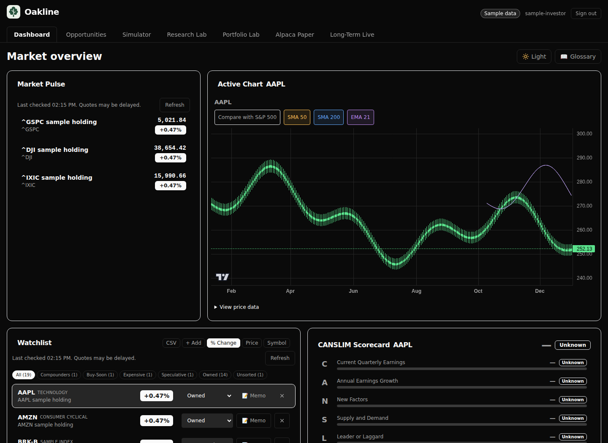
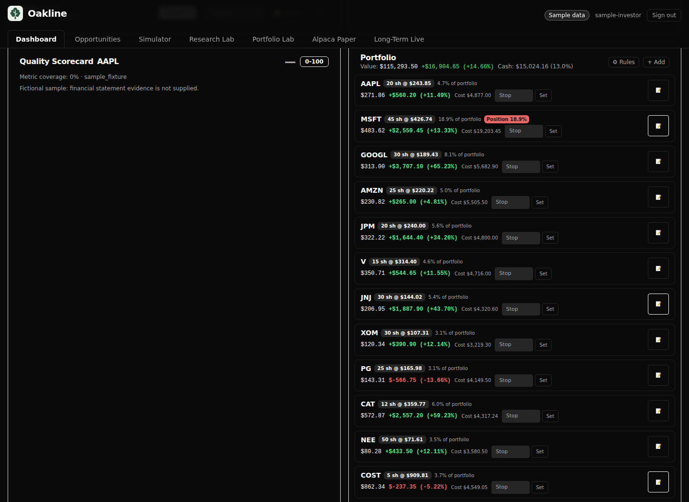
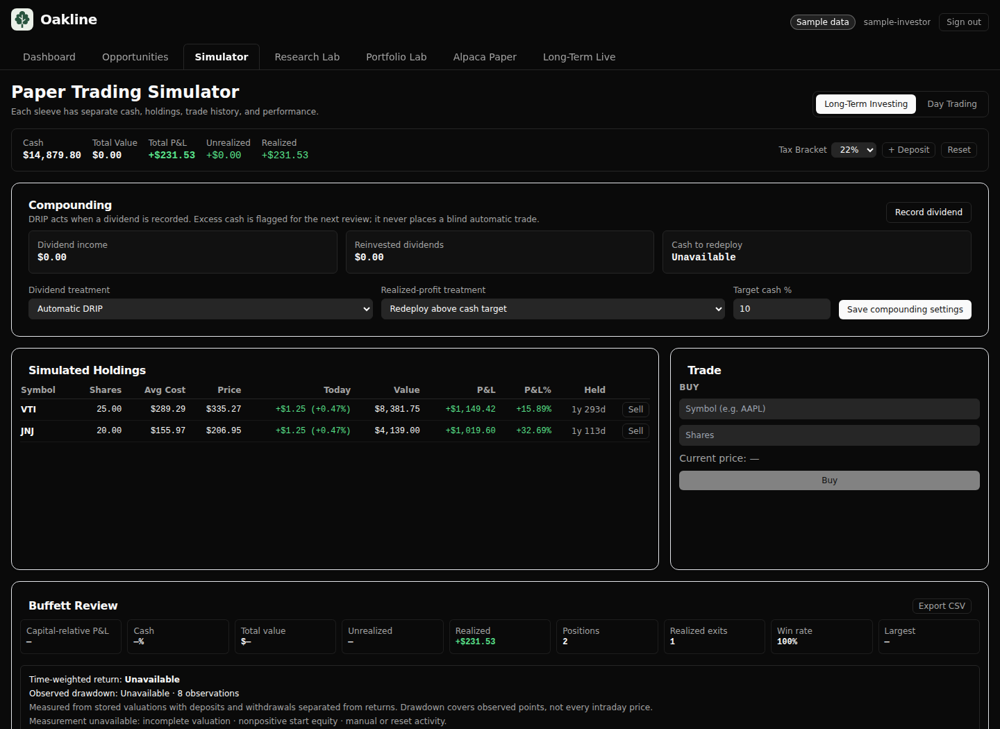
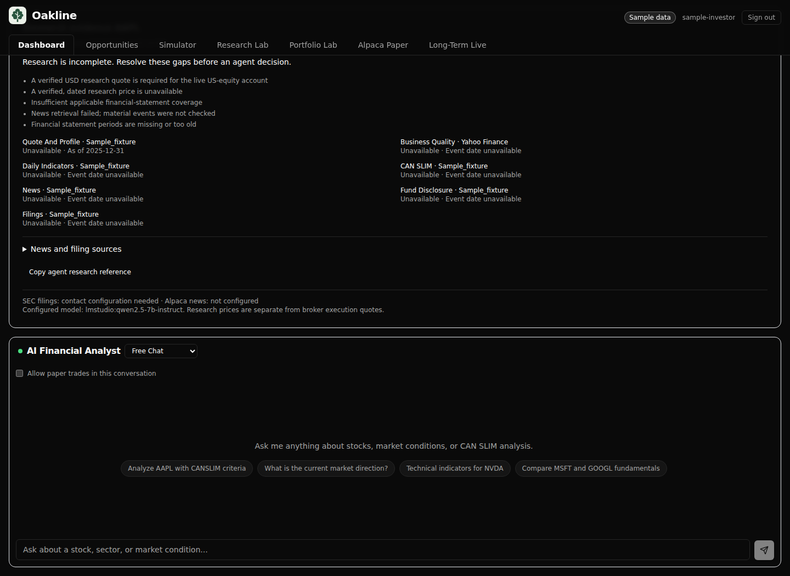
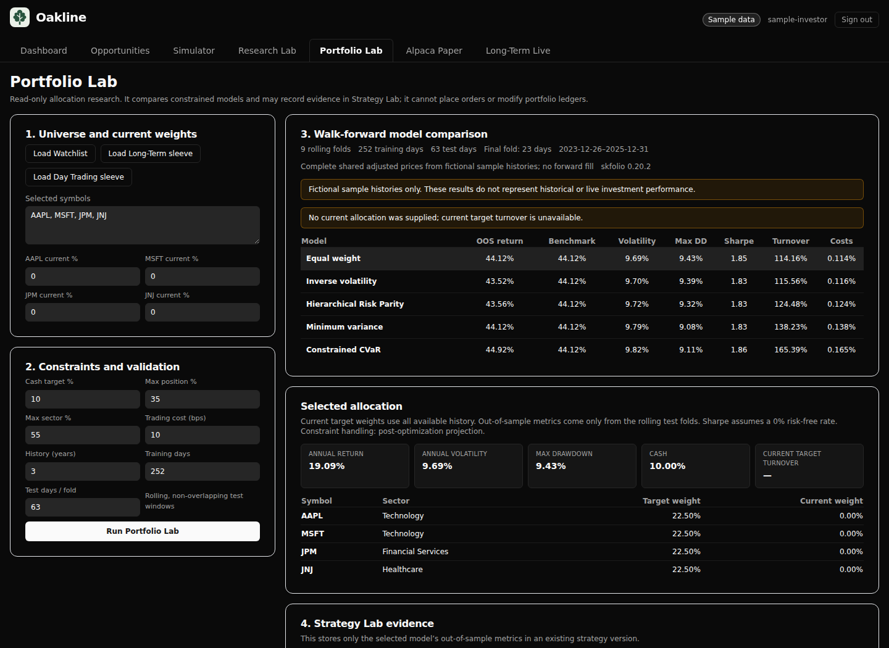
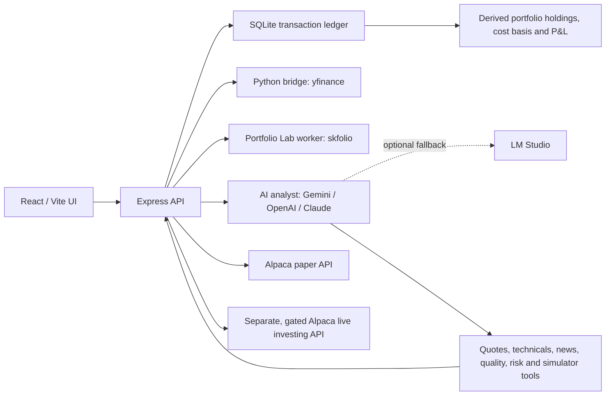

# Stock Dashboard

A self-hosted stock research and paper-trading workbench I use myself. It brings
market data, a transaction-ledger portfolio, risk rules, and an AI analyst with
tools into one app. The screenshots below use a fictional portfolio in a separate
sample database.



| Portfolio and risk rules | Paper-trading simulator |
|---|---|
| [](docs/screenshots/02-portfolio.png) | [](docs/screenshots/04-simulator.png) |

[](docs/screenshots/03-ai-analyst.png)

Live OpenAI response on the fictional account: the risk tool reports MSFT at
18.15% against a 15% position limit. No trades were requested or executed.

[](docs/screenshots/05-portfolio-lab.png)

**Two-minute walkthrough:** recording pending. There is no hosted demo; use the
[local sample setup](#local-sample-portfolio) to explore it yourself.

## What I built and owned

I owned the scope, architecture decisions, testing, deployment, and operations.
Built with AI coding agents, whose commits appear under **Stock Dashboard
Contributors**. My work includes defining the ledger and execution boundaries,
verifying behavior with tests, and diagnosing integration failures across Node,
Python, market-data providers, and paper-trading APIs.

## How it fits together



## Safety design, with evidence

| Boundary | Implementation | Enforcing tests |
|---|---|---|
| The paper broker client rejects the live Alpaca endpoint. | [Paper client](backend/services/alpaca_paper_service.js) | [Non-paper endpoint rejection](backend/test/alpaca_paper_service.test.js) |
| Live investing uses separate credentials, account binding, reviewed allocation limits, durable order intents and operator-controlled execution mode. | [Live service](backend/services/alpaca_live_investing.js), [capabilities](backend/services/api_capabilities.js) | [Order safety](backend/test/alpaca_live_investing.test.js), [HTTP authorization](backend/test/alpaca_live_routes.test.js) |
| Manual paper-order entry is disabled by default. | [Order route](backend/routes/alpaca_paper.js) | [No broker request while disabled](backend/test/alpaca_paper_order_submission.test.js) |
| The v2 entry gate checks the kill switch, reconciliation, and monitor health; raw orders cannot bypass v2 account ownership. | [Entry gate](backend/services/alpaca_day_trade_v2_execution.js), [raw order gate](backend/routes/alpaca_paper.js) | [Entry refusals](backend/test/alpaca_day_trade_v2_execution.test.js), [account-wide route gate](backend/test/alpaca_day_trading_v2_routes.test.js) |
| Simulator API tokens are scoped to one sleeve and its allowed operations. | [Capabilities](backend/services/api_capabilities.js) | [Cross-sleeve and operation denials](backend/test/simulator_capabilities.test.js) |
| Chat receives an explicit tool allowlist; simulator trades still require the shared execution checks. | [AI tools](backend/services/ai_service.js) | [Tool scope, schemas and trade checks](backend/test/ai_simulator_tools.test.js) |
| Single-user login, capability-checked API access, and loopback binding by default. | [Authentication](backend/services/auth.js), [server](backend/server.js) | [Login and access tests](backend/test/auth.test.js), [listen configuration](backend/test/server_config.test.js) |
| Sample mode requires its marked database and uses separate credentials. | [Sample guards](backend/services/sample_mode.js), [launcher](backend/scripts/start-sample.js) | [Isolation and seed checks](backend/test/sample_mode.test.js) |

## Numbers

Counts reflect this branch's source files and passing full-suite or targeted test runs;
they change as the app evolves.

| Measure | Count |
|---|---:|
| Backend JavaScript tests / test files | 758 / 79 |
| Frontend tests / test files | 88 / 27 |
| API route files | 19 |
| Standalone migration files | 2 |

Schema initialization also lives in `backend/database/db.js`. See [Tests](#tests)
for the commands, including the separate Portfolio Lab Python checks.

## Hard problems

- **One fill, two delivery paths:** [canonicalized REST activity IDs](https://github.com/reviaro/stock-app/commit/bf424bbeade55eee7e15917894458775df95ade3) so WebSocket and REST reconciliation don't double-count a fill.
- **Partial market-data bars:** [normalized finite Yahoo bars and strict JSON output](https://github.com/reviaro/stock-app/commit/c3f4955b786e5a71451e76c9af38f5376938b5bd) so missing values cannot break the Python-to-Node boundary.
- **Cancel versus fill:** [fixed a cancel/fill race](https://github.com/reviaro/stock-app/commit/f728b1a593e8479943cb6beb5eff290d3a63e956) in the paper execution lifecycle.

## Features

- **Market dashboard** — market pulse, sector rotation, stock charts, CANSLIM
  scorecard, quality scorecard (moat/health metrics), daily price history
  snapshots with range filtering, and a glossary.
- **Watchlist with buckets** — compounders / buy soon / expensive / speculative /
  owned / unsorted, with automatic bucket flips as you buy and sell.
- **Portfolio ledger** — every buy, sell, dividend, deposit, and withdrawal is a
  transaction row; cost basis (weighted average), cash, and realized/unrealized
  P&L are derived from the ledger, never stored.
- **Risk rails** — configurable position/sector/cash limits and per-symbol stop
  losses, with breach chips surfaced in the portfolio panel.
- **Research journal** — per-stock memos (thesis, fair value range, buy/trim
  levels, invalidation, conviction) plus structured research notes, with AI
  draft and bear-case pressure-test helpers.
- **Value screener** — scores candidates on quality vs. valuation.
- **Portfolio Lab** — read-only skfolio allocation research comparing equal
  weight, inverse volatility, HRP, minimum variance, and constrained CVaR with
  rolling walk-forward validation and optional Strategy Lab evidence capture.
- **AI analyst** — chat agent with tool access to live quotes, technicals,
  news, quality metrics, risk checks, and the simulator; plus five one-shot
  analyst modes (decision memo, bear case, compare, weekly review, monthly
  review). Supports Gemini, OpenAI API, Anthropic Claude API, and LM Studio.
- **Paper-trading simulator** — two isolated sleeves (Long-Term Investing and
  Day Trading), each with its own cash, holdings, trade history, FIFO tax
  preview (short/long-term split by your bracket), performance review, and CSV
  export. The AI agent can trade in either sleeve via `account_id`.
- **Long-Term Live** — a separate Alpaca stocks/ETF workspace with an editable
  simulator-allocation import, protected external holdings, cash and position
  limits, individual order confirmation or scoped strategy-agent execution,
  broker fill reconciliation, and explicit ownership review.

## Safety and scope

This project is educational and research software, not financial advice. It
does not guarantee returns. Paper and live broker integrations use separate
credentials and fixed endpoints. Both start with order submission disabled.
Live investing additionally starts paused and unfunded; its account binding,
allocation limits and execution mode must be reviewed before activation.

Use only your own locally supplied credentials. Never commit API keys, session
secrets, runtime databases, portfolio exports, logs, or other personal
financial data.

## Architecture

```
frontend/   React 19 + TypeScript + Vite + Tailwind + React Query (port 5173, proxies /api → 3002)
backend/    Express (port 3002) + SQLite (backend/database/stocks.db) + node:test
  python/   yf_wrapper.py — yfinance quotes/quality/news via a venv (pybridge spawns it)
  portfolio_lab/  isolated skfolio worker, tests, requirements, and dedicated venv
```

The backend also serves `frontend/dist`, so a production build runs entirely
from port 3002.

## Setup

### Prerequisites

- Node.js **24** is recommended and used by CI. The frontend also supports
  Node.js **20.19+** or **22.12+** within those major versions; earlier versions
  cannot run the installed Vite and jsdom dependencies.
- Python **3.11 or newer** (required by the backend's `pandas` dependency)

### Backend

```bash
cd backend
npm install
python3 -m venv venv && venv/bin/pip install -r python/requirements.txt
python3 -m venv portfolio_lab/venv && portfolio_lab/venv/bin/pip install -r portfolio_lab/requirements.txt
cp .env.example .env   # configure the required auth values documented below
node server.js         # http://localhost:3002
```

`.env` keys:

| Key | Purpose |
|-----|---------|
| `AI_PROVIDER` | `gemini` (default), `openai`, `anthropic`, or `lmstudio`; applies to chat, modes, memo drafts, and pressure tests |
| `AI_MODEL` | Model ID; required for OpenAI/Anthropic. Empty uses stable `gemini-2.5-flash`; an explicit model is never silently substituted |
| `AI_LOCAL_FALLBACK` | `true` or `false`; cloud-to-local fallback is opt-in; keyless local installations retain local selection. Never switches between cloud providers |
| `GOOGLE_GENERATIVE_AI_API_KEY` | API key for Gemini |
| `OPENAI_API_KEY` | API key for OpenAI |
| `ANTHROPIC_API_KEY` | API key for Anthropic Claude |
| `LMSTUDIO_BASE_URL` | Local model server (default `http://localhost:1234/v1`); uses Chat Completions |
| `LMSTUDIO_MODEL` | Model name as shown in LM Studio's server tab |
| `PYTHON_PATH` | Optional override for the venv python used by pybridge |
| `STOCK_DASHBOARD_USERNAME` | Required single-user login name |
| `STOCK_DASHBOARD_PASSWORD_HASH` | Required scrypt password hash; never store the plaintext password |
| `STOCK_DASHBOARD_SESSION_SECRET` | Required random session-signing secret of at least 32 characters |
| `STOCK_DASHBOARD_API_TOKEN` | Optional read-only bearer token for non-browser automation |
| `STOCK_DASHBOARD_ALLOW_LOOPBACK` | Permit tightly validated read-only `127.0.0.1` automation without a browser login; defaults to `1` |
| `STOCK_DASHBOARD_SIMULATOR_TOKENS` | JSON array of distinct `{account_id, token, manage_limits?}` credentials; tokens must contain at least 32 characters. Simulator trades are scoped to one sleeve; optional limit management does not grant operator powers. |
| `STOCK_DASHBOARD_HOST` | `127.0.0.1` by default; use `0.0.0.0` only in guarded LAN proxy mode |
| `STOCK_DASHBOARD_TRUSTED_PROXY_IP` | Exact LAN IPv4 allowed to proxy requests when `HOST=0.0.0.0`; all other non-loopback clients are rejected |
| `STOCK_DASHBOARD_PUBLIC_ORIGIN` | Exact HTTPS browser origin used for mutation Origin checks, such as `https://stocks.example.com` |
| `STOCK_DASHBOARD_SECURE_COOKIE` | Required explicit `0` or `1`; guarded LAN proxy mode requires `1` |
| `PYTHON_TIMEOUT_MS` | Maximum runtime for each market-data Python process; defaults to 45 seconds |
| `PYTHON_MAX_OUTPUT_BYTES` | Combined Python stdout/stderr limit; defaults to 5 MiB |
| `PORTFOLIO_LAB_PYTHON` | Optional override for the isolated Portfolio Lab Python executable |
| `PORTFOLIO_LAB_TIMEOUT_MS` | Maximum Portfolio Lab worker runtime; defaults to 180 seconds |
| `PORTFOLIO_LAB_MAX_OUTPUT_BYTES` | Combined Portfolio Lab worker output limit; defaults to 10 MiB |
| `ALPACA_API_KEY` / `ALPACA_API_SECRET` | Optional Alpaca **paper** credentials; never commit real values |
| `ALPACA_LIVE_API_KEY` / `ALPACA_LIVE_SECRET_KEY` | Optional separate Alpaca **live** credentials; server-side only |
| `ALPACA_LIVE_ACCOUNT_ID` | Expected live account ID; every broker operation checks this identity |
| `ALPACA_LIVE_TRADING_ENABLED` | Explicit server submission gate; defaults to false |
| `STOCK_DASHBOARD_LIVE_INVESTING_TOKEN` | Optional distinct 32+ character credential for a scoped long-term strategy agent |
| `ALPACA_TRADING_BASE_URL` | Must remain `https://paper-api.alpaca.markets`; live endpoint is rejected |
| `ALPACA_PAPER_ORDER_ENTRY_ENABLED` | Paper-order master switch; disabled unless explicitly set to `true` |
| `ALPACA_PAPER_ORDER_ENTRY_TOKEN` | Independent token required by the paper-order and reconciliation routes |
| `DB_PATH_OVERRIDE` | Override the database used by Node and the Python cache reader/updater; unset keeps `backend/database/stocks.db` |
| `ENABLE_LEDGER_MIGRATION` | One-time legacy portfolio→ledger migration gate; leave unset for new installations and back up before migration |

Generate a password hash without putting the password in shell history:

```bash
cd backend
read -rsp "New password: " NEW_PASSWORD; echo
NEW_PASSWORD="$NEW_PASSWORD" node -e \
  "console.log(require('./services/auth').hashPassword(process.env.NEW_PASSWORD))"
unset NEW_PASSWORD
```

Copy the resulting `scrypt$...` value into `STOCK_DASHBOARD_PASSWORD_HASH`.
Generate `STOCK_DASHBOARD_SESSION_SECRET` with a cryptographically random secret,
for example `openssl rand -base64 48`. Restarting the backend invalidates existing
browser sessions.

### AI provider configuration

Set these values in `backend/.env`, or in **`backend/.env.sample`** when using
`npm run start:sample`. Restart that backend after changing them. Keys stay on
the server; the browser cannot choose a different provider or supply credentials.

| Provider | Settings |
|----------|----------|
| Gemini | `AI_PROVIDER=gemini`, `GOOGLE_GENERATIVE_AI_API_KEY=...`; optionally set `AI_MODEL` |
| OpenAI API | `AI_PROVIDER=openai`, `OPENAI_API_KEY=...`, `AI_MODEL=<your model ID>` |
| Anthropic Claude API | `AI_PROVIDER=anthropic`, `ANTHROPIC_API_KEY=...`, `AI_MODEL=<your model ID>` |
| LM Studio | `AI_PROVIDER=lmstudio`, `LMSTUDIO_MODEL=<loaded model name>`; no cloud key needed |

Choose an API model that supports tool calling. OpenAI uses the
[Responses API](https://developers.openai.com/api/docs/guides/function-calling);
Claude uses the [Anthropic adapter](https://ai-sdk.dev/providers/ai-sdk-providers/anthropic).
These integrations use API keys, not Codex or Claude Code CLI logins.

Gemini uses a stable default. Set `AI_MODEL` to a model enabled in the server's
provider account to pin a selection; a pinned model has no implicit backup model.
Cloud-to-local fallback requires `AI_LOCAL_FALLBACK=true`. Existing installations
without a cloud key can still select the local model. No fallback switches cloud
providers. Streaming fallback stops once response content or tool input begins.
Actual provider/model identity is returned in `X-AI-Model` and retained with the
private research audit. Paper buy/sell tools are unavailable in chat until the
operator enables **Allow paper trades in this conversation**.

All providers receive the same permitted dashboard tools and simulator checks.
The selected provider receives the conversation and any tool/context data used
to answer it. OpenAI requests set `store: false`. For recordings, use only the
sample portfolio and a key explicitly configured in `.env.sample`.

### Frontend

```bash
cd frontend
npm install
npm run dev     # http://localhost:5173 (proxies /api to 3002)
npm run build   # emits frontend/dist, served by the backend
```

### Local sample portfolio

Use this checkout to prepare screenshots and recordings with a fictional account.
After installing the prerequisites and dependencies above, run from the repo root:

```bash
cd frontend
npm run build
cd ../backend
npm run seed:sample
npm run start:sample
```

Open **http://127.0.0.1:3003** and sign in with **sample-investor** /
**sample-portfolio**. The header shows **Sample data**. These are public demo
credentials for a loopback-only local server; do not publish or proxy this mode.
The sample uses a separate session cookie, so it does not replace a normal login
on the same hostname. The ordinary `npm start` command is unchanged.

`seed:sample` creates only this checkout's `backend/database/sample.db`. It uses
the app's schema initialization/migrations and ledger functions, takes no CLI
arguments, and never reads the normal `.env`. An inherited `DB_PATH_OVERRIDE`
pointing anywhere else makes it refuse to run. It refuses symlinks, hard links,
unmarked existing databases and SQLite sidecars. Stop the sample server before
running the seed again: reseeding replaces the fictional account, including edits
made during a demo. A failed build preserves the previous sample database.
The generated database and lock files are git-ignored.

The fixture contains a $100,000 January 2025 deposit, 12 stocks and two ETFs,
buys/sells through December, illustrative dividends, one withdrawal, all six
watchlist buckets, three research memos with notes, risk rules, and trades in both
simulator sleeves. See [the scenario](backend/fixtures/sample/scenario.json),
[fixed price inputs](backend/fixtures/sample/prices.json), and
[expected accounting](backend/fixtures/sample/expected.json).
Trades use Yahoo Finance daily closes retrieved through yfinance with
`auto_adjust=False`, rounded to cents; the fixture records retrieval provenance.
Fills and dividend cash flows are fictional, not actual execution or distribution
records. Same-day simulator round trips use the same reference close plus fees;
they are not evidence of an intraday strategy's performance.

Reseeding needs no network. Expected portfolio cash is **$15,024.16**, realized
P&L is **$190.50**, and at the fixture's **2025-12-31** closes the only breach is
MSFT's position weight (**18.9%**, against a **15%** limit). The running app still
uses current market data when you open or refresh a page: values, P&L and breach
counts can change. Sample mode disables the universe-cache startup warm-up and
scheduled refresh, scheduled watchlist snapshots, and simulator performance
sampling. Normal mode keeps all three jobs enabled. This is not an offline or
frozen recording mode.

Before each capture, confirm the **Sample data** badge, check that all 14 holdings
have prices, and review the portfolio's cash and breach chips. The intended scene
has one MSFT position breach. If live prices change that scenario, adjust only the
fictional account's risk rules and check again; do not describe live values as the
dated fixture values. Do not trade or edit the account between related captures.

`start:sample` supplies an absolute database override, validates the seed marker
before initialization, binds to `127.0.0.1:3003`, and creates a fresh session secret.
It never seeds on startup or loads your normal `.env`, inherited broker keys,
operator tokens, or model credentials. Alpaca is unconfigured and broker order
entry stays disabled. Normal mode retains its existing database, auth and jobs.

For optional AI access, copy `backend/.env.sample.example` to
`backend/.env.sample` and configure a separate model key or a local LM Studio
model. Only the documented model/Python settings in that file are accepted by
the launcher; other settings are ignored. Live AI calls can incur provider costs.
The file is ignored by Git. No model call is required to seed or start the sample.

For frontend development against the sample backend:

```bash
cd frontend
VITE_DEV_BACKEND_TARGET=http://127.0.0.1:3003 npm run dev
```

Use a separate browser profile for recording. If an abnormal shutdown leaves
`backend/database/sample.db.lock`, first confirm no sample server or seed process
is running (the file contains its PID), then remove only that lock and retry.
Do not delete SQLite sidecars while a database process is running.

## Tests

See [simulator controls and evaluation](docs/simulator-controls.md) for the
scoped automation contract, adjustable risk limits, immutable runs, and rollout
requirements. New evaluated buys require an explicitly configured risk policy.

```bash
cd backend && npm test        # isolated node:test suite; no application credentials needed
cd backend && venv/bin/python -m unittest discover -s python -p 'test_quality.py' -v
cd backend && portfolio_lab/venv/bin/python -m unittest portfolio_lab/test_worker.py -v
cd frontend && npm test       # vitest + testing-library
cd frontend && npx tsc -b     # type check
cd frontend && npm run lint
```

`npm test` in the backend clears inherited application settings, disables local
`.env` loading in test processes and their Node children, and assigns temporary
SQLite databases before application imports. Database fixtures use unique
operating-system temporary directories, including their journals and migration
backups. Each file runs in its own process; do not disable test process isolation.
Tests use mocked market-data and broker responses and local HTTP/WebSocket
fixtures. They require local socket access, but no external API credentials or
market-data requests. Install the Python environments above before running them.

To run one backend file, use `npm test -- test/portfolio_ledger.test.js` from
`backend/`. The launcher allows two minutes per test file and twenty minutes for
the suite. CI runs the backend, frontend, and Portfolio Lab checks on pull requests.

## Long-Term Live investing

The **Long-Term Live** tab can be configured before adding broker credentials.
Use the blank settings in `backend/.env.example`; real values belong only in
the server environment. Live requests use `https://api.alpaca.markets` and never
fall back to the paper keys. Bind the expected live account ID, review the
capital ceiling and target weights, then deliberately enable the server gate
and unpause the UI policy. Automatic mode requires its own activation phrase.
Allocation uses the smaller of the ceiling and current account equity after
excluding protected external holdings, so weights track funded capital through
market gains, losses and deposits without borrowing.
Pausing prevents new orders; use the order controls to cancel existing app orders.

Importing account 1's simulator allocation creates an editable weights draft.
Review every symbol: mutual funds are not automatically mapped to ETFs.
Simulator DRIP transactions, hypothetical fills and tax estimates never become
live transactions. Live cash income remains at Alpaca; allocation reviews can
redeploy available cash within the approved capital ceiling. The app does not
modify Alpaca's dividend-election settings or initiate cash transfers.

Existing holdings are protected until an operator explicitly reviews ownership
while trading is paused and all orders are settled. Quantity discrepancies,
including external trades or corporate actions, block further trading until
reviewed. An uncertain submission remains reserved until broker reconciliation
finds its unique client order ID; it is never retried with a fresh order ID.

A strategy agent uses a separate bearer credential supplied through
`STOCK_DASHBOARD_LIVE_INVESTING_TOKEN`. It can read research, simulator account 1,
and `GET /api/alpaca-live/overview`; it cannot change policy, adopt holdings,
cancel orders, or access day-trading submissions. Read the current `version`
and policy from the overview before submitting a decision:

```json
{
  "account_id": 1,
  "policyVersion": 1,
  "decisionKey": "unique-allocation-review-id",
  "symbol": "AAPL",
  "side": "buy",
  "reason": "Analysis supporting this adjustment within the approved allocation.",
  "analysis": {
    "packetId": "<id from GET /api/research/AAPL>",
    "contentHash": "<hash returned with that packet>",
    "strategyVersion": "reviewed-strategy-v1",
    "analyzedAt": "<current ISO timestamp after fetching the packet>",
    "model": "<agent provider and model>",
    "claims": [{"path": "data.info.price", "value": "<numeric price from that packet>"}],
    "assumptions": ["Explicit assumption used in the investment thesis"],
    "alternatives": ["Keep the existing allocation and wait"],
    "invalidation": "The measurable condition that invalidates the thesis."
  }
}
```

Send that JSON to `POST /api/alpaca-live/decisions`. Use the actual current
policy version and a unique key for each distinct decision. Shares and limit
prices are calculated by the server from approved allocation drift, fresh
Alpaca IEX bid/ask evidence and cash limits; agents cannot supply them. In
confirmation mode, review the decision in the UI and confirm a fresh preview.
In automatic mode, an eligible decision may submit one DAY limit order
immediately. This mode responds to agent requests and does not run a timer.
Read the overview to reconcile and wait for a terminal order state before the
next decision. Accepted and partially filled orders are not completed trades.

Implementation references: [Alpaca orders](https://docs.alpaca.markets/us/docs/orders-at-alpaca),
[fractional trading](https://docs.alpaca.markets/docs/fractional-trading), and
the [official JavaScript SDK sources](https://github.com/alpacahq/alpaca-trade-api-js).
The app keeps its existing patched HTTP transport and does not retry order POSTs.

## Notes

- The simulator's two sleeves live in `simulator_sleeves`; all simulator API
  routes and AI tools accept `account_id` (1 = long-term, default; 2 = day
  trading).
- Tax preview uses FIFO lot matching and your configured US bracket; long-term
  rates apply to lots held ≥ 365 days.
- Runtime databases and their backups may contain sensitive portfolio and
  transaction data. They are ignored by Git and must never be committed.

## License

Licensed under the MIT License. See [LICENSE](LICENSE).

## Research evidence and evaluation

Normal operation returns unavailable data on provider failure. Synthetic prices,
scorecards and charts are restricted to the isolated sample environment. Missing
financial values are not zero; scorecards show metric coverage and unknown criteria.
Company financial ratios are calculated over matching fiscal periods. Funds use
separate costs, benchmark and dated-holdings research rather than corporate grades.

`GET /api/research/:symbol` returns the shared UI/agent evidence packet, source
provenance, missing-data blockers, immutable ID and content hash. It distinguishes
provider event dates from retrieval time. `?refresh=1` collects a new packet.
AI tools and generated briefs use a compact projection with measured scores and
recent references. Complete statements and filing archives remain available through
`GET /api/research/packets/:id`; the content hash identifies that complete saved
record. Partial references or holdings in a chat summary do not establish full coverage.
Research prices never replace execution quotes. CAN SLIM price, volume and ownership
proxies are labeled explicitly; custom-universe relative strength is not an official
IBD rating. The universe refresh replaces a coherent cohort atomically and retains
the previous cohort if coverage fails.

Optional `SEC_USER_AGENT` identifies the application and a contact email to the
[SEC APIs](https://www.sec.gov/search-filings/edgar-application-programming-interfaces).
Keep the actual contact value in the server environment. Standard US-GAAP USD facts
retain fiscal dates, accession numbers and filing cutoffs; unsupported facts remain
missing. SEC is preferred for statement calculations when coverage is sufficient;
Yahoo fallback remains explicitly labeled. Broad screener requests return dated research inputs while primary statement caches warm with bounded concurrency; per-symbol research waits for its source result. Optional dedicated
`ALPACA_RESEARCH_API_KEY` / `ALPACA_RESEARCH_SECRET_KEY` enable
[Alpaca news](https://docs.alpaca.markets/us/reference/news-3). Neither source is
required to start the app, and configuration/availability is visible in research.

An operator can record an issuer disclosure with
`POST /api/research/fund-disclosures` using `symbol`, `benchmark`,
`expenseRatioPct`, `asOf`, `issuerUrl`, `holdings: [{symbol, weightPct}]` and the exact
attestation `I VERIFIED THIS ISSUER DISCLOSURE`. Verification is operator-attested,
not independently authenticated by the server. Disclosures expire after 90 days;
undisclosed holdings remain unknown in look-through exposure analysis.

Agent live requests require an eligible saved research packet and analysis within
30 minutes. Claims must match typed fields in that packet. Assumptions, alternatives,
invalidation, strategy version and agent-reported model identity are retained
privately and linked to reconciled order/fill outcomes. Confirmation rechecks the
research evidence. This supplements the independent broker execution guards;
it does not establish that the investment thesis is correct.

The Strategy Research Lab includes prospective agent evaluations. Freeze the model,
strategy version, benchmark, collection window, outcome horizon, cost assumption
and minimum sample before collecting distinct-symbol buy/hold/avoid decisions.
The server records immutable, dividend/split-adjusted histories. New evaluations
measure the horizon in calendar days after the next common completed closing entry;
exit is the first common completed close on or after that maturity. One-day horizons
therefore require distinct entry and exit sessions. Existing evaluations retain their
frozen decision-date timing; a legacy horizon with no positive holding period is
explicitly excluded and requires a new evaluation. The server does not accept
caller-supplied returns. Outcomes are
research observations, not executed portfolio returns or verified live readiness.
No evaluation automatically promotes a strategy. The existing simulator evidence
and risk gates remain separate. DCF scenarios require an explicit enterprise or equity
cash-flow basis; equity cash flow cannot subtract net debt again. Memo drafts omit
numeric valuation targets when no verified scenario is provided.

Research packets, disclosures, agent analysis, model/tool audit traces and evaluation
records stay in the private application database. Never add database copies,
credentials, personal strategy plans or internal review artifacts to Git.
